<a href="https://amrita-kadam.vercel.app/">portfolio</a> &nbsp;·&nbsp;
<a href="https://www.linkedin.com/in/amrita-kadam-2a293b287">linkedin</a> &nbsp;·&nbsp;
<a href="mailto:amrita0205kadam@gmail.com">email</a>

> Final-year B.Tech CSE at IIIT Raichur and mechanistic interpretability 
> research intern at Moleculyst. I work on LLM hallucination detection, 
> evaluation and multi-agent systems — and I test where things fail.

Right now I'm reproducing published LLM reliability methods and checking whether 
they hold up on other open models, while building practical RAG and multi-agent 
systems. I care about both what a model's hidden states give away and the 
engineering needed to turn an experiment into a usable product.

<samp>open to Applied Scientist and AI/ML research internships · from now or January 2027</samp>

<samp>python &nbsp; pytorch &nbsp; hugging face transformers &nbsp; scikit-learn &nbsp; nlp &nbsp; hallucination detection &nbsp; langgraph &nbsp; langchain &nbsp; crewai &nbsp; rag &nbsp; chromadb &nbsp; fastapi &nbsp; django &nbsp; postgresql &nbsp; mongodb &nbsp; git &nbsp; github actions</samp>

**[MultiHaluDet reproduction](https://github.com/Amrita0205/multihaludet-reproduction)** &nbsp;·&nbsp; <samp>pytorch, transformers, hallucination detection</samp> 
Reproduced an ACL 2026 workshop method that detects LLM hallucinations from a frozen 
model's hidden states (AUROC 0.985 vs. 0.984 reported), then ran it on Qwen2.5, 
Phi-3.5 and Yi-1.5: all four models score 0.985–0.989. Found a cross-validation bug 
in the released code that inverted its ensemble's predictions. 
[repo](https://github.com/Amrita0205/multihaludet-reproduction) &nbsp;·&nbsp;
[results](https://github.com/Amrita0205/multihaludet-reproduction/blob/main/RESULTS_README.md)

**[Veda AI](https://github.com/Amrita0205/Extraction-and-Answer-Mapping-Veda-AI)** &nbsp;·&nbsp; <samp>next.js, fastapi, gemini vision</samp> 
Question paper in, handwritten answer sheet in. Extracts questions and answers, 
maps out-of-order answers, tightens highlights onto actual ink, and grades. 
Fixing a silent fallback took highlight IoU from 0.29 to 0.89; page time 176s → 2.2s. 
[repo](https://github.com/Amrita0205/Extraction-and-Answer-Mapping-Veda-AI) &nbsp;·&nbsp;
[live app](https://extraction-and-answer-mapping-veda-nine.vercel.app)

**[GhostRead](https://github.com/Amrita0205/ghostreader)** &nbsp;·&nbsp; <samp>python, tkinter, pymupdf</samp> 
Transparent always-on-top PDF reader with Windows click-through and ghost mode. 
Ships a Windows executable, PyPI package, tests, releases, and CI. 
[repo](https://github.com/Amrita0205/ghostreader) &nbsp;·&nbsp;
[PyPI](https://pypi.org/project/ghostread/)

**[Agentic AI Career Advisor](https://github.com/anandn1/career-advisor)** &nbsp;·&nbsp; <samp>langgraph, chromadb, rag</samp> 
Team of four. I wrote the supervisor that orchestrates the LangGraph agents 
(job-market analysis, skill-gap detection, resume strategy, mock interviews, 
learning-path planning). Advice is grounded with RAG over ChromaDB. 
[team repo](https://github.com/anandn1/career-advisor) &nbsp;·&nbsp;
[demo](https://youtu.be/56Xtd1PNetw)

**[Blog Writing Agent](https://github.com/Amrita0205/Blog_writing_AI_agent)** &nbsp;·&nbsp; <samp>crewai, groq</samp> 
Four agents (Researcher, Writer, Editor, Social) turn a topic into a publication-ready 
post plus Twitter/X and LinkedIn variants on Groq llama-3.3-70b.

> Part-time model debugger, full-time space daydreamer.

By day I probe language models to see what's going on in there: 
what their hidden states give away, and why a model can be 
so confident and so wrong at the same time. The dream is models 
we can actually read, not just run and hope.

By night I'm usually thinking about space. Somewhere out there a 
star is being born, another is quietly collapsing, and a planet 
nobody has named yet is doing laps around both. It's oddly calming. 
The universe ships things half-finished and figures it out later too.

Turns out it's the same hobby twice: staring at something huge and 
complicated and asking "okay, but what's happening inside?"

The rest of the time I'm dancing, singing, or drawing. 
None of them professionally. All of them with full commitment.

<samp>currently: probing LLM hidden states for hallucinations &nbsp;·&nbsp; wondering about dying stars &nbsp;·&nbsp; doodling in margins</samp>

<a href="https://github.com/Amrita0205?tab=repositories">all repositories →</a>

